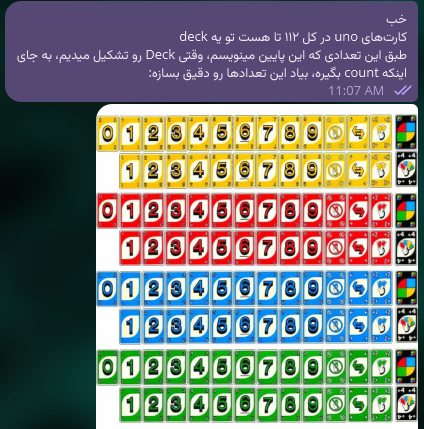

- Make Deck() Class create specific cards

- add shuffle() function to Deck() Class

- make Player() class:
hand (list)
username

- add draw() function to Deck() class
کشیدن کارت

- add add_card() function to Player() class